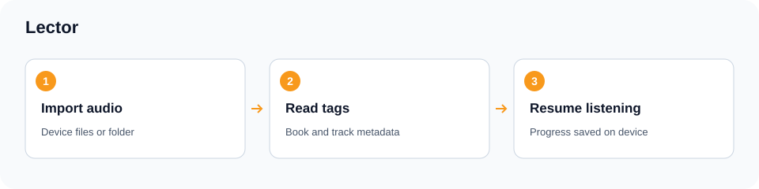
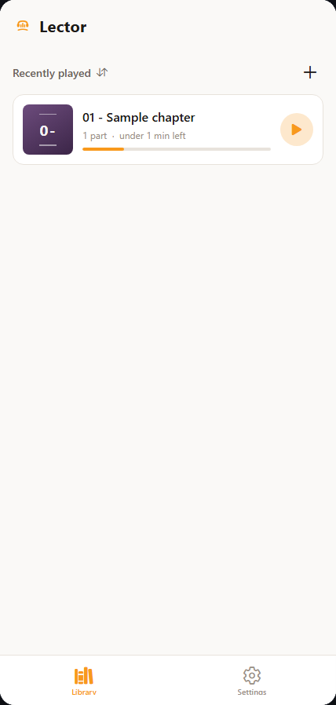
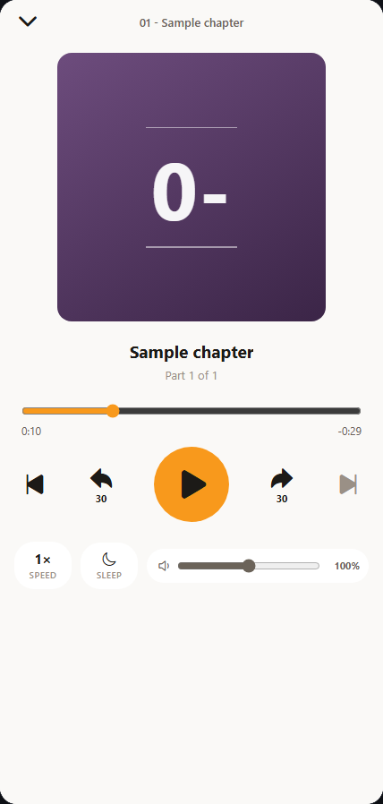

# Lector

A local audiobook player for Android and a phone-sized PC browser window, built with Expo and React Native. Import audio files or choose a device folder, browse books and tracks, and resume listening from saved progress.



## Use on this PC

Double-click **Open PC.cmd**. It opens Lector in a phone-sized browser window on this computer. No phone, QR scan, Expo account or pairing is needed. The first opening can take 20-60 seconds while the local JavaScript bundle compiles.

If dependencies are missing, install Node.js and run **Setup PC.cmd** once, then open **Open PC.cmd** again. Setup downloads the versions in package-lock.json; normal launches use the installed dependencies in offline mode.

**Stop PC.cmd** stops this app's local server. Closing the window leaves that reusable server available for at most two hours after the latest launch; repeated launches reuse it and renew that limit. After source edits, Stop and reopen to load the new code.

The local URL is `http://localhost:8181/phone.html`. Expo runs only as the local compiler/server, bound to localhost, with two workers. The phone frame stays at most 430 pixels wide even in a large browser window. No emulator is installed.

Saved PC data belongs to the dedicated browser profile at `%LOCALAPPDATA%/Marino/PCAppPreviews/lector`, separate from a phone and your regular browsing profile. Keep the same port and profile; clearing browser data removes its local copy. [PC runtime notes](docs/PC-PREVIEW.md) describe storage, checks and limitations.

## Phone view

Actual PC captures use a short synthetic audio file, not a personal audiobook. Import audio files from this PC, open a book and press Play. Audio copies are stored in IndexedDB; settings and listening progress are stored locally. Keep the original audio files as your backup.

 

[Screenshot notes](docs/screenshots/README.md).

## Optional native development

`npm start` starts the Expo development server. Use an Expo SDK 53 compatible development client for native work. Android device-folder scanning and volume boost above 100% require the native app; the PC version imports selected files and uses the browser's supported audio codecs. iOS development needs macOS. No background playback or mobile behavior is certified by the PC checks.

## Use

Import files or a folder from the Library, open a book, and select a track. The player supports seeking, playback speed, a sleep timer and saved per-track progress. Settings and progress use AsyncStorage on native devices and local browser storage on PC. Back up your original audio separately.

Metadata readers handle ID3, MP4 and FLAC/Vorbis tags. Files above the metadata reader's 80 MB limit fall back to filename hints; this limit concerns tag inspection.

## Project map

| Path | Purpose |
| --- | --- |
| `app/` | Library, settings, book and player screens |
| `context/` | Library, playback, theme and persistence state |
| `services/` | File import, storage and audio playback |
| `metadata/` | Byte-level audio tag parsers |
| `modules/volume-boost/` | Android LoudnessEnhancer bridge |
| `components/Logo.tsx`, `scripts/generate-icon.js` | App mark and PNG generation |

## Checks and continuation

```powershell
npm test -- --runInBand
npm run typecheck
npm run lint
```

Read [AGENTS.md](AGENTS.md) before editing. Keep native seek timing, SAF content URIs and metadata fallbacks intact. This documentation update does not certify a new mobile release or device test.
